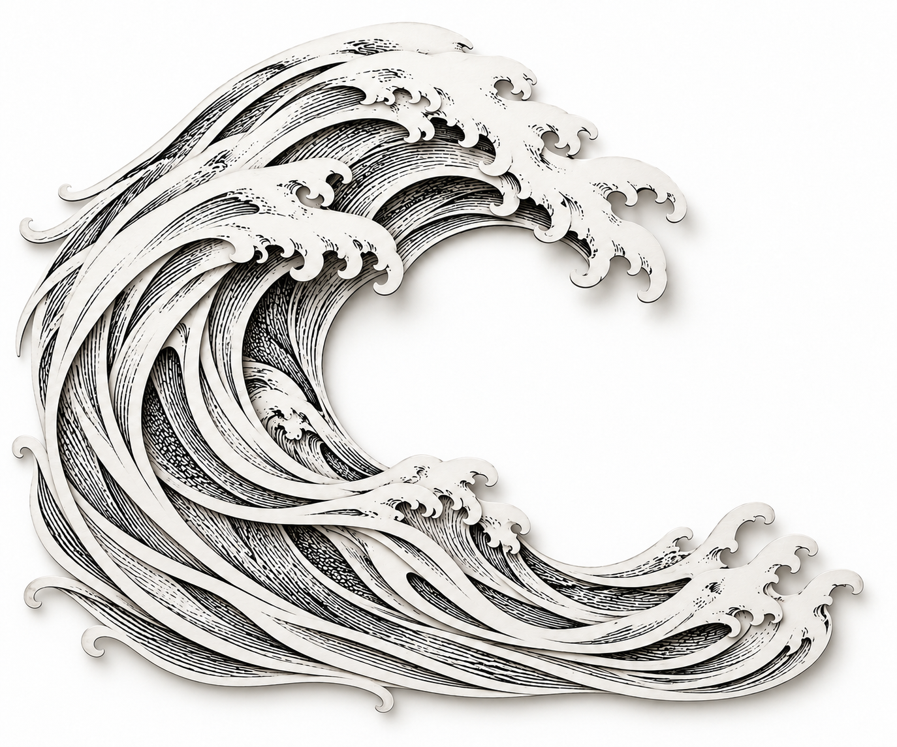
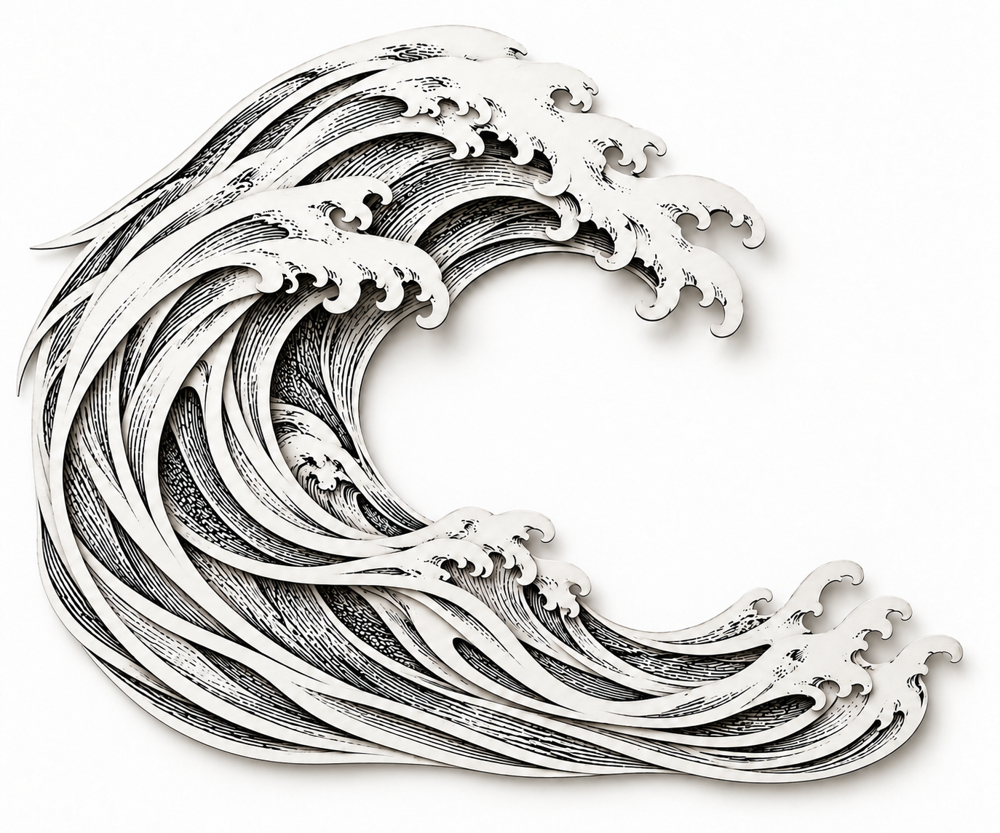
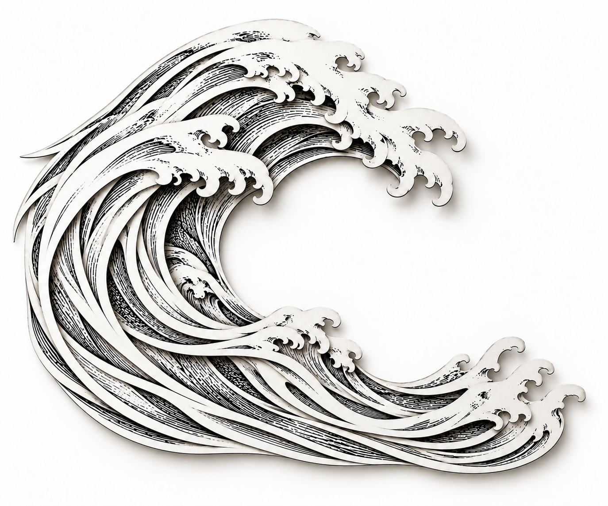
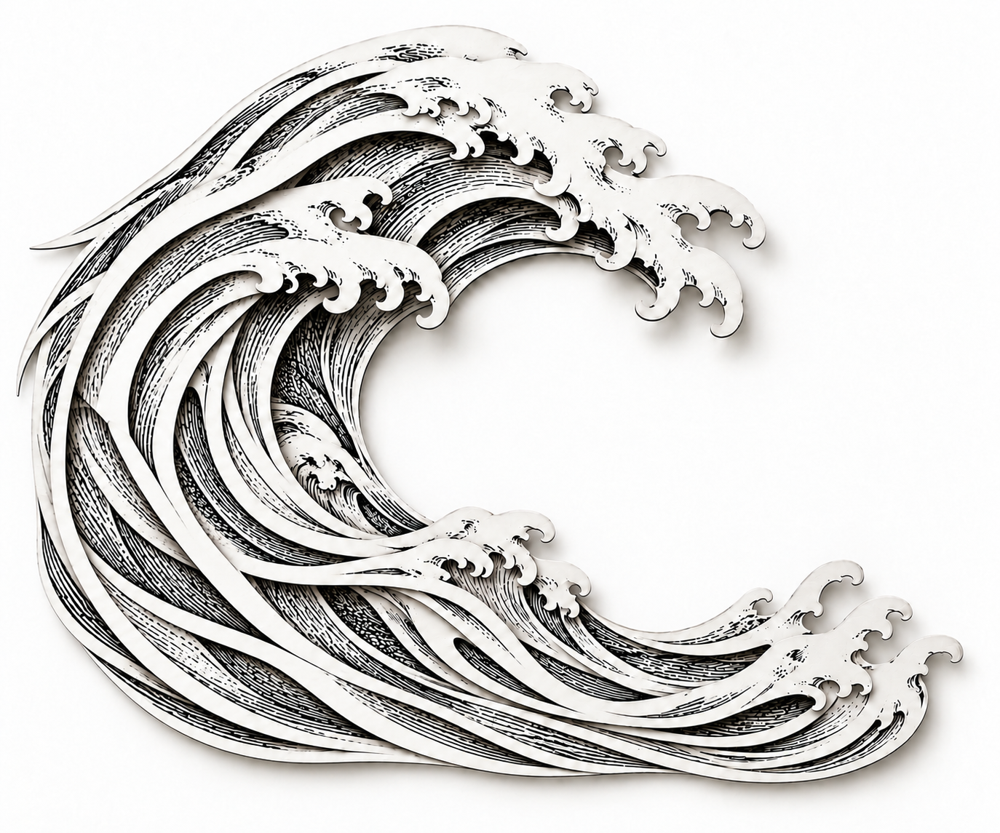

# Estudos papercut — revisão visual

Imagens geradas com IA, não fotografias de objetos físicos nem arquivos em camadas. O site não foi alterado. Plano: [método e limites](../../../docs/design/papercut-estudo-visual.md). [Prompts iniciais](prompts.md) e [prompts de refinamentos e estados](prompts-refinamentos.md).

**Comece pela [imagem recomendada: C refinado](05-refinamento-recortes-planos.png).** Esta é uma recomendação do assistente; aprovação do usuário pendente.

## Comparação inicial

Escala: 0 = ausente; 1 = parcial ou ambíguo; 2 = convincente na imagem. Avaliação visual qualitativa do assistente, não medição objetiva de geometria. A aprovação estética do usuário continua pendente.

| Estudo | Recorte | Profundidade | Revelação | Gravura | Continuidade | Potencial de movimento | Total |
| --- | --- | --- | --- | --- | --- | --- | --- |
| A — fino | 1 | 1 | 1 | 2 | 1 | 1 | 7/12 |
| B — profundo | 2 | 2 | 2 | 2 | 1 | 1 | 10/12 |
| C — detalhado | 2 | 2 | 2 | 2 | 1 | 2 | 11/12 |

### A — recorte fino

Boa linguagem de gravura. A sombra sob a crista sugere papel, mas o corpo permanece predominantemente uma superfície desenhada. A borda esquerda sai do enquadramento; as hachuras internas não se distinguem como peças. Não recomendado como referência principal do efeito.

### B — recorte profundo

Faixas brancas sobre hachuras inferiores mostram profundidade por toda a curva. A crista é excessivamente fragmentada: ilhas e pequenas pontas dificultam identificar quais formas pertencem a cada folha. Algumas conexões entre planos são ambíguas. Boa referência de profundidade, menos adequada para continuidade simples de movimento.

### C — contorno detalhado — recomendação provisória

Os recortes longos têm silhuetas mais identificáveis. A crista simplificada permite acompanhar cada faixa; hachuras aparecem nos intervalos. O potencial de movimento é mais legível, mas ainda não comprovado tecnicamente. A borda vertical esquerda e a base horizontal fazem a composição parecer uma placa. Faixas brancas largas reduzem a delicadeza buscada. Refinamento proposto: eliminar o contorno de placa e reduzir a largura de algumas faixas, mantendo a estrutura.

## Limites observados

- A geração independente não manteve composição exatamente igual entre as três imagens. A comparação é de direção, não um experimento com todas as variáveis controladas.
- Quantidade exata de camadas e espessura física não podem ser verificadas em PNG achatado.
- A sombra pode simular separação que não existe como geometria reconstruível.
- Não há animação nesta entrega. Não foram validados fluidez, interpolação, máscaras ou desenho oculto completo.
- Os arquivos são estudos de direção; não substituem assets finais com transparência e peças independentes.

## Refinamentos

### Rodada 1 — bordas orgânicas

Hipótese: eliminar a borda de placa e estreitar faixas reforçaria a aparência de recorte. Resultado: a borda retangular foi eliminada, mas o estreitamento foi apenas parcial. Regressão: surgiram pontas enroladas na borda esquerda e inferior, sugerindo dobras. A direção geral e a crista foram preservadas. Essa regressão motivou a segunda rodada.

### Rodada 2 — recortes planos — imagem recomendada

Hipótese: corrigir somente as pontas enroladas preservaria as melhorias anteriores. Resultado: as pontas ficaram afiladas e a base orgânica foi mantida. O corpo apresenta faixas independentes legíveis e gravura inferior aparente. Persistem faixas largas e algumas conexões ambíguas; o prompt não controla geometria exata nem quantidade verificável de folhas. Sombras ainda são uma interpretação visual do gerador.

Pontuação qualitativa: recorte 2, profundidade 2, revelação 2, gravura 2, continuidade 1, potencial de movimento 2 — **11/12**. A nota igual à de C não significa ausência de melhoria: o refinamento resolveu problemas de contorno externo, enquanto a incerteza de continuidade geométrica permanece.

## Estudos de estado

Ambos foram gerados separadamente a partir da imagem 05, para evitar acumular alterações de uma edição na outra.

### Fechado

Mantém a silhueta e a linguagem, com sobreposições compactas. O fechamento solicitado foi sutil; houve redesenho de hachuras, pequenas pontas e posições. Não comprova encaixe perfeito das mesmas peças.

### Aberto

As aberturas aumentaram principalmente no lado esquerdo e no terço inferior, expondo faixas hachuradas. A intenção de revelação ficou visível. Contudo, apareceram encontros angulosos e mudanças de desenho nas regiões abertas: não é uma simples translação das mesmas peças. Algumas tiras sugerem torção em vez de deslocamento plano. Portanto, esta imagem é referência do gesto desejado, **não referência final aprovada de construção**.

### Resultado da comparação

- Aparência geral de papel, gravura e profundidade: satisfatória como direção provisória.
- Revelação de desenhos inferiores entre contornos: visível.
- Preservação exata da geometria entre estados: não atingida.
- Continuidade temporal, fluidez e funcionamento do efeito: não testados, pois não existe animação nesta etapa.
- Método validado para explorar aparência e realizar correções locais. Método não validado para gerar uma sequência consistente de frames ou camadas separadas.

## Integridade e reprodução

As sete imagens foram verificadas como PNG RGB, 1374 × 1145 px (proporção 6:5), com fundo opaco. O manifesto `manifesto.json` registra tamanho e SHA-256 de cada arquivo. Os prompts registram as intenções; novas gerações não têm garantia de resultado idêntico.

## Progresso e próxima ação

Ciclo inicial concluído: três estudos, duas rodadas de refinamento e dois estados. O trabalho parou no limite acordado. Nenhum HTML, CSS, JavaScript, gerador ou asset usado pelo site foi alterado.

Escolha recomendada: imagem 05. A próxima decisão é do usuário: confirmar se a materialidade, a espessura visual do papel e a profundidade estão próximas da referência desejada. Se não estiverem, coletar o desvio específico antes de uma nova rodada. Construção de peças e animação permanecem fora do escopo desta entrega.
