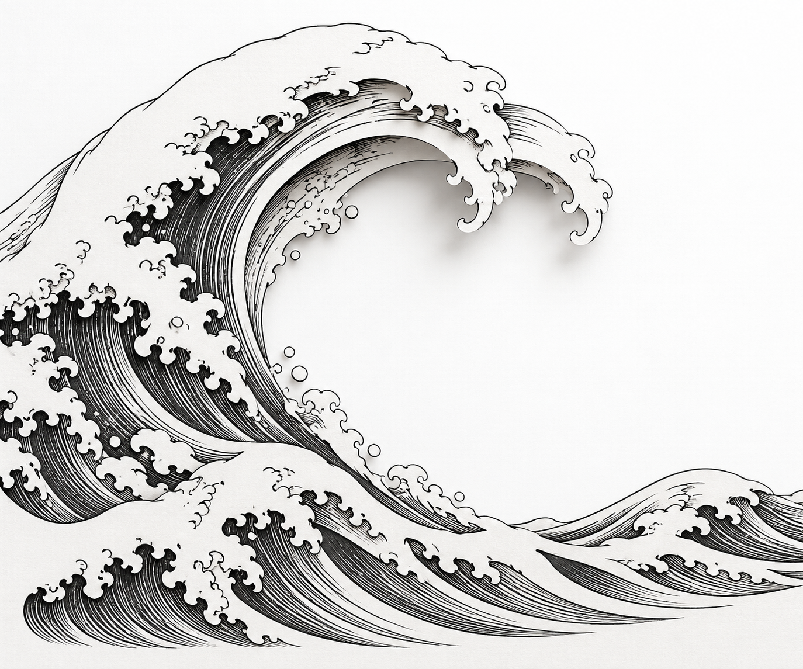
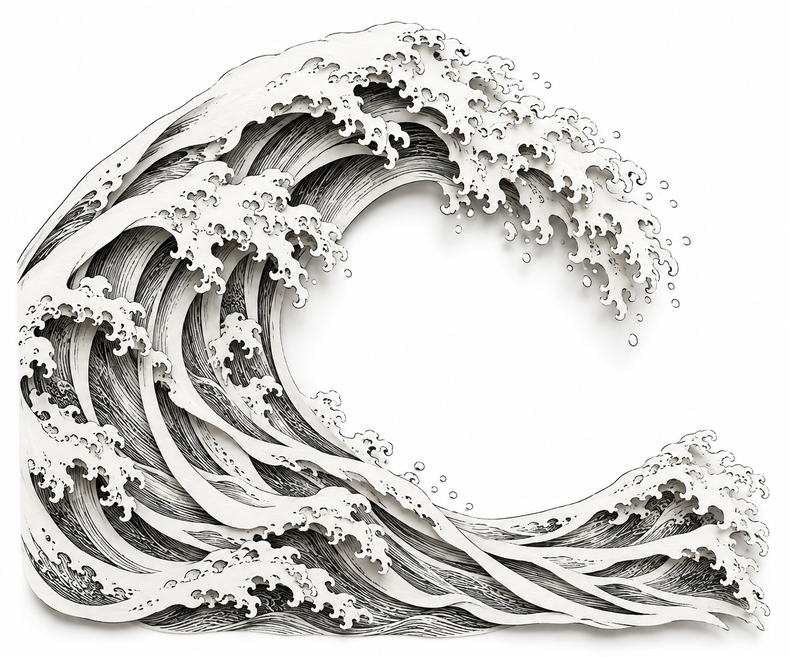
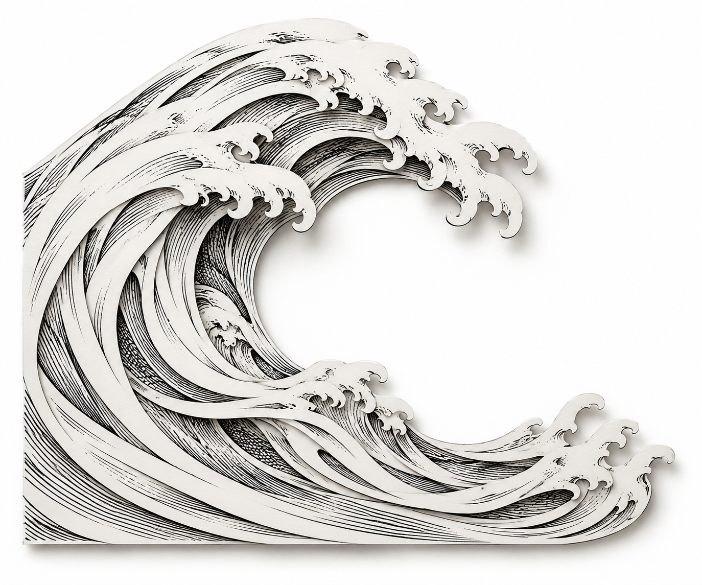

# Estudos papercut — revisão visual

Imagens geradas com IA, não fotografias de objetos físicos nem arquivos em camadas. O site não foi alterado. Plano: [método e limites](../../../docs/design/papercut-estudo-visual.md). [Prompts exatos](prompts.md).

## Comparação inicial

Escala: 0 = ausente; 1 = parcial ou ambíguo; 2 = convincente na imagem. Avaliação visual qualitativa do assistente, não medição objetiva de geometria. A aprovação estética do usuário continua pendente.

| Estudo | Recorte | Profundidade | Revelação | Gravura | Continuidade | Potencial de movimento | Total |
| --- | --- | --- | --- | --- | --- | --- | --- |
| A — fino | 1 | 1 | 1 | 2 | 1 | 1 | 7/12 |
| B — profundo | 2 | 2 | 2 | 2 | 1 | 1 | 10/12 |
| C — detalhado | 2 | 2 | 2 | 2 | 1 | 2 | 11/12 |

### A — recorte fino

Boa linguagem de gravura. A sombra sob a crista sugere papel, mas o corpo permanece predominantemente uma superfície desenhada. A borda esquerda sai do enquadramento; as hachuras internas não se distinguem como peças. Não recomendado como referência principal do efeito.

### B — recorte profundo

Faixas brancas sobre hachuras inferiores mostram profundidade por toda a curva. A crista é excessivamente fragmentada: ilhas e pequenas pontas dificultam identificar quais formas pertencem a cada folha. Algumas conexões entre planos são ambíguas. Boa referência de profundidade, menos adequada para continuidade simples de movimento.

### C — contorno detalhado — recomendação provisória

Os recortes longos têm silhuetas mais identificáveis. A crista simplificada permite acompanhar cada faixa; hachuras aparecem nos intervalos. O potencial de movimento é mais legível, mas ainda não comprovado tecnicamente. A borda vertical esquerda e a base horizontal fazem a composição parecer uma placa. Faixas brancas largas reduzem a delicadeza buscada. Refinamento proposto: eliminar o contorno de placa e reduzir a largura de algumas faixas, mantendo a estrutura.

## Limites observados

- A geração independente não manteve composição exatamente igual entre as três imagens. A comparação é de direção, não um experimento com todas as variáveis controladas.
- Quantidade exata de camadas e espessura física não podem ser verificadas em PNG achatado.
- A sombra pode simular separação que não existe como geometria reconstruível.
- Não há animação nesta entrega. Não foram validados fluidez, interpolação, máscaras ou desenho oculto completo.
- Os arquivos são estudos de direção; não substituem assets finais com transparência e peças independentes.

## Progresso

Três estudos gerados e inspecionados. Recomendação provisória: C. Seleção estética do usuário pendente; refinamentos e estados aberto/fechado ainda não gerados.
