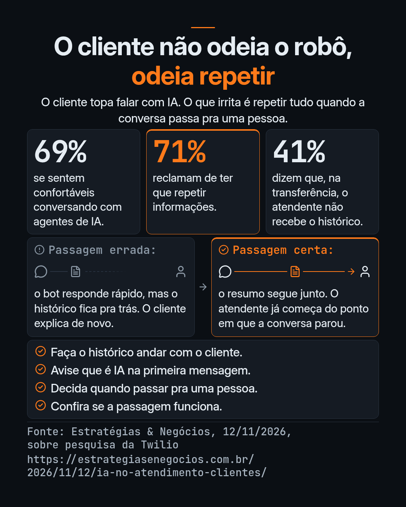

Cenário ilustrativo. A loja, a Helena e o pedido são fictícios.

A Helena escreve no WhatsApp da loja. O pedido 1847 devia ter chegado ontem. Ela já manda o número, o que comprou e o endereço. O bot pede o CPF, ela envia, e a conversa vai pra um atendente.

O atendente entra: "Oi, como posso ajudar?" Ela explica de novo. Depois a conversa passa pra expedição, e outra pessoa pede o número do pedido.

O robô respondeu rápido. O que cansou foi ter que contar a mesma história três vezes.

Se você cuida do atendimento de um pequeno ou médio negócio, essa cena provavelmente já aconteceu com um cliente seu. Muita gente acha que o problema é a pessoa não querer falar com robô. Uma reportagem recente sobre uma pesquisa aponta pra outro lugar.

## O que a pesquisa mostra

Segundo reportagem da Estratégias & Negócios sobre pesquisa da Twilio, 69% dos entrevistados no Brasil se sentem confortáveis conversando com agentes de IA.

O que aparece com força é a perda de contexto. 71% reclamam da necessidade de repetir informações durante o suporte. E 41% dizem que, quando o atendimento é transferido de um sistema automático pra uma pessoa, o profissional não recebe o histórico da conversa anterior.

A reportagem também registra que a velocidade das respostas, sozinha, não garante uma experiência boa. A lição que eu tiro daí: o ganho vem de passar o histórico adiante na transferência, não de responder mais rápido.

## O que isso muda no dia a dia

Em muita operação pequena, o atendimento começa num WhatsApp, num formulário ou num chatbot, e em algum momento precisa de uma pessoa. É aí que a conversa quebra: se o histórico não segue, o cliente repete o que já tinha dito.

Eu trabalho com IA e automação pra atendimento, organização e processos, e já fiz automação pra tipos de negócio como cartório, delivery e chatbot.

Um caso do meu tempo de seguros: na renovação de um plano de saúde empresarial de 15 vidas, o cliente já tinha mandado tudo na adesão. Nome, CPF e RG de cada pessoa, o tipo de plano, a data de vencimento. Na renovação, precisava mandar tudo de novo. Os dados existiam, só não andavam junto com ele.

Isso já importa se você tem duas pessoas respondendo mensagem e um bot na frente. No começo, a correção é combinar o que viaja junto com o cliente, e conferir se isso acontece.

## O que o histórico precisa levar na transferência

Quando a conversa passa pra uma pessoa, o atendente deveria começar do ponto em que o cliente parou. O histórico precisa chegar junto, curto o bastante pra ler rápido.

No mínimo, eu levaria:

1. Quem é o cliente, e por qual canal ele entrou.
2. O que ele pediu, nas palavras dele, não só numa categoria genérica.
3. O que já foi coletado: número de pedido, documento, endereço, protocolo, data, o que estiver no caso.
4. O que o sistema já tentou fazer, e o que já foi respondido.
5. Por que a conversa está sendo transferida: o bot não resolve, o cliente pediu uma pessoa, falta uma decisão ou um dado.
6. O que ainda está em aberto, e o que o cliente já espera.

Não precisa ser um relatório. Precisa ser um resumo que o atendente lê em poucos segundos e já consegue continuar. Se for longo demais, tende a ser ignorado. Leve só o que é necessário pra seguir o atendimento, e garanta que quem recebe de fato vê esse resumo, não só que ele "está no sistema".

## Avise que é IA já na primeira mensagem

A mesma reportagem trata de transparência. Segundo ela, 92% dos entrevistados querem ser informados com clareza quando estão falando com uma inteligência artificial ou com uma pessoa. Pra 80%, essa identificação deve acontecer logo na primeira mensagem.

Na prática, a primeira mensagem do canal automático diz, em linguagem comum, que o atendimento começa com um assistente automático, e que uma pessoa pode entrar se for preciso. Sem letra miúda, e sem fingir que tem alguém digitando do outro lado. Quando uma pessoa assume, vale deixar isso claro também.

## Quando passar pra uma pessoa

O automático dá conta de muita coisa repetida: consultar um status, mandar um documento padrão, registrar um pedido que já tem regra. Tem hora em que a conversa precisa de alguém.

Alguns sinais razoáveis pra passar:

- O cliente pede pra falar com uma pessoa.
- O caso sai do que o sistema sabe resolver: exceção, reclamação, decisão que muda um valor, um prazo ou um direito.
- Falta um dado que o automático não consegue obter, e insistir só atrasa.
- O cliente já repetiu a mesma coisa, ou demonstra que não está sendo entendido.
- A ação tem consequência que você não quer deixar só com a máquina.

O ponto não é eliminar o automático, nem passar tudo pra alguém. É ter uma porta clara, e usá-la antes de o cliente cansar.

Quando passar, passe de verdade: com o histórico junto, e com o atendente começando daí. Transferir e recomeçar é a passagem errada da cena da Helena.

## Como conferir se a passagem funciona

Não adianta só desenhar o fluxo. Precisa ver se ele aguenta um caso real.

1. Faça você mesmo o caminho do cliente: abra o canal, explique um pedido concreto e peça pra ser transferido.
2. Olhe o que chegou na tela de quem atende. O resumo está lá? Dá pra entender o pedido, o que já foi tentado e o que falta, sem perguntar de novo?
3. Veja a primeira fala do atendente. Se for "Como posso ajudar?" ou "Pode me passar o número do pedido?", a passagem ainda não está funcionando.
4. Repita com dois ou três tipos de caso: uma consulta simples, uma exceção e um cliente que pede pessoa logo de início.
5. Acompanhe se o cliente está repetindo informação depois da transferência. A reportagem aponta que preservar o histórico e manter a continuidade da conversa devem entrar nos indicadores, junto com a resolução no primeiro contato. Pra começar, anote uns casos na semana.

Se a passagem falhar, o conserto em geral não é um robô que responde melhor. É garantir que o resumo é montado, que chega em quem atende, e que a pessoa usa o que chegou.

## Pra fechar

O cliente, na maior parte dos casos que a reportagem descreve, topa conversar com IA. O que ele não topa é explicar de novo o que já explicou.

Se você está montando ou ajustando um atendimento automático, comece por essa passagem: o que o histórico leva, o aviso de que é IA na primeira mensagem, quando uma pessoa entra, e a conferência com um caso real.

Não é garantia de resultado. É um ponto concreto pra parar de fazer o cliente repetir.

## Fonte

Os números deste artigo foram lidos na reportagem da Estratégias & Negócios de 12 de novembro de 2026, sobre a pesquisa da Twilio "Tendências de Engajamento com o Cliente no Brasil". Não consultei o relatório original. Consulta feita em 13 de novembro de 2026.

[IA no atendimento é aceita por 69%, mas 71% repetem dados, Estratégias & Negócios](https://estrategiasenegocios.com.br/2026/11/12/ia-no-atendimento-clientes/)
